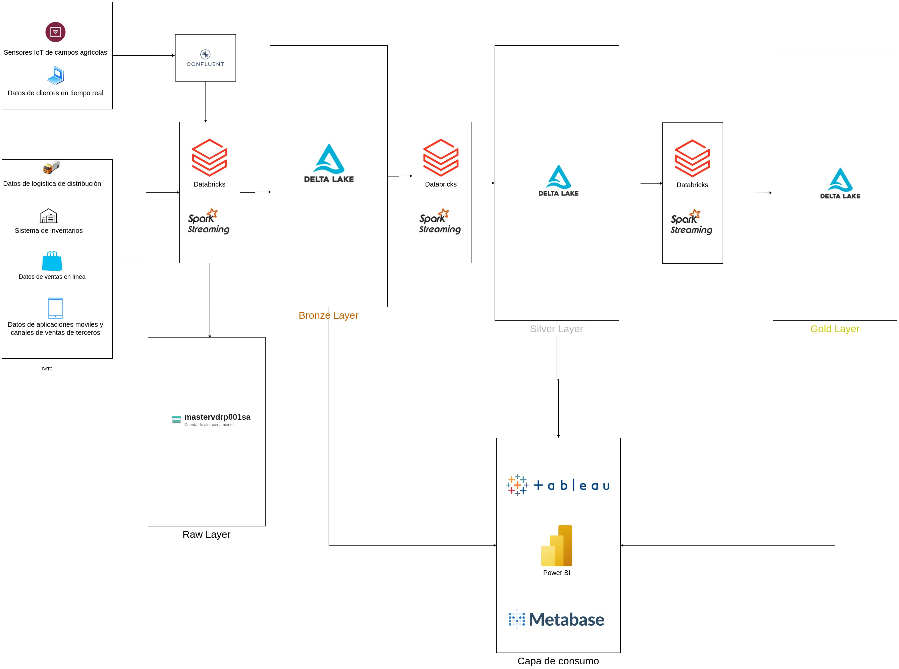

# Data Ingestion Pipelines into an Azure Data Lakehouse

Batch and streaming ingestion into an Azure Data Lakehouse (Azure Databricks + ADLS Gen2 + Delta Lake) following a Medallion architecture (raw → bronze → silver → gold), including real-time events from Kafka (Confluent Cloud) with Avro schemas.

Part of the Master's in Big Data & Data Engineering (UCM).



## Highlights

- **Configurable ingestion engine** ([`final-project/src/motor_ingesta/motor_ingesta_v10.py`](final-project/src/motor_ingesta/motor_ingesta_v10.py)): a single, config-driven engine (`final-project/config/config.json`) that ingests batch files and Kafka/Avro events into Delta Lake, with a raw-file archiver and shared utilities.
- **Streaming ingestion**: Spark Structured Streaming from Kafka (Confluent Cloud), Avro deserialization through Confluent Schema Registry, single-plex and multiplex patterns.
- **Incremental file ingestion**: Databricks Auto Loader for JSON and images, full and incremental loads.
- **End-to-end Medallion pipeline**: MovieLens dataset processed through bronze, silver and gold layers.
- **Kafka client**: minimal Python producer/consumer for Confluent Cloud.

## Repository structure

```
entrega/            Final graded project: batch + streaming ingestion notebooks, architecture diagram, report (PDF, in Spanish)
final-project/      Configurable ingestion engine (Python/PySpark) and its configuration
ejercicios/         Weekly labs: Parquet/Delta Lake, Auto Loader, event ingestion (JSON/Avro), MovieLens medallion pipeline
streaming-client/   Confluent Cloud Kafka Python producer/consumer
```

## Security

No credentials are stored in this repository. Scripts that use Confluent Schema Registry read the key from the `SCHEMA_REGISTRY_API_KEY` and `SCHEMA_REGISTRY_API_SECRET` environment variables, and `streaming-client/client.properties.example` uses placeholders.

## Stack

Azure Databricks · ADLS Gen2 · Delta Lake · Spark Structured Streaming · Auto Loader · Apache Kafka / Confluent Cloud · Schema Registry · Avro · Python · PySpark

---
**Author:** Víctor Daniel Rodríguez Pérez
